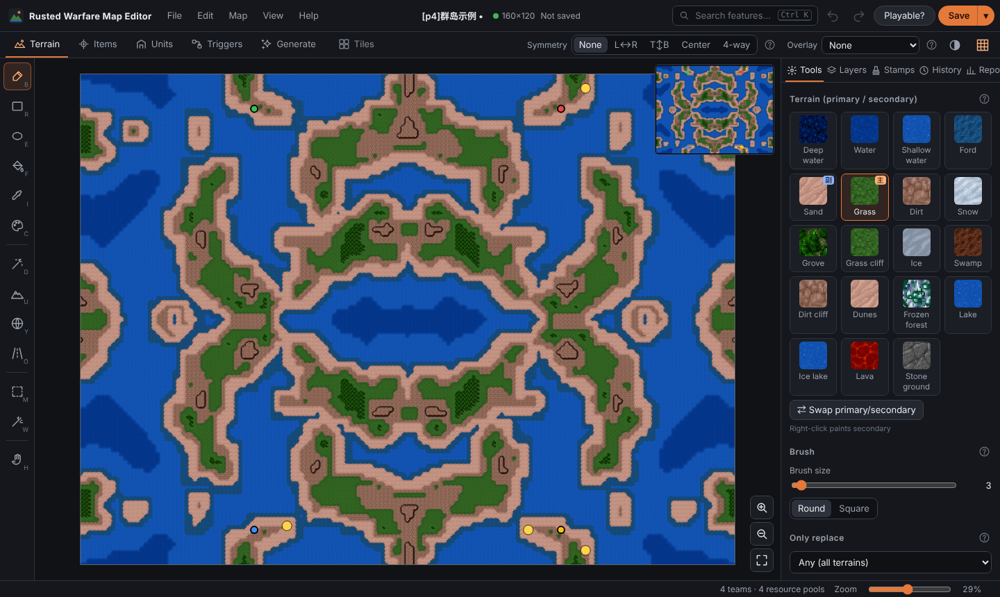

# Rusted Warfare マップエディタ

[中文](README.md) · [繁體中文](README.zh-TW.md) · [English](README.en.md) · **日本語** · [Русский](README.ru.md) · [Español](README.es.md)

**Rusted Warfare** 用の無料の非公式エディタです。**マップエディタ** と **Mod エディタ** が入っています。Android 中心ですが、PC のブラウザでも使えます。

- マップ：地形を選んでなぞるだけで、海岸や崖は自動でつながります。スタート地点と資源プールはワンタップで配置。半分描いてミラー。トリガーは「〜したら〜する」のカードで作れます。「遊べる？」ボタンでチェックし、多くの問題はワンタップで直せます。
- Mod：生の ini ではなくフォームでユニットを編集。ユニットの複製、バリエーション生成、数値の一括スケール。比較表と戦闘シミュレーション。画像・音の不足や参照ミスを検出して、`.rwmod` にパックします。

## はじめかた

1. [Releases](https://github.com/WeaverVictorWings/rw-map-editor/releases/latest) からダウンロード：スマホは `rw-map-editor.apk` をインストール、PC は `rw-map-editor-web.zip` を展開して `Start-Editor.bat` をダブルクリック。
2. まず手持ちの Rusted Warfare のマップ（.tmx）を 1 つ開きます。タイルの素材はそこから取り込みます（ゲームの素材は同梱していません）。
3. マップを作成・編集し、「遊べる？」でチェックして、「ゲームフォルダに保存」してプレイ。

ホーム画面で **マップエディタ**（初心者におすすめ）か **Mod エディタ** を選べます。どちらにもチュートリアルがあります。

不具合・要望は [Issues](https://github.com/WeaverVictorWings/rw-map-editor/issues/new/choose) へ。ライセンス：[MIT](LICENSE)。ゲームの素材は開発元のものであり、このリポジトリには含まれません。
