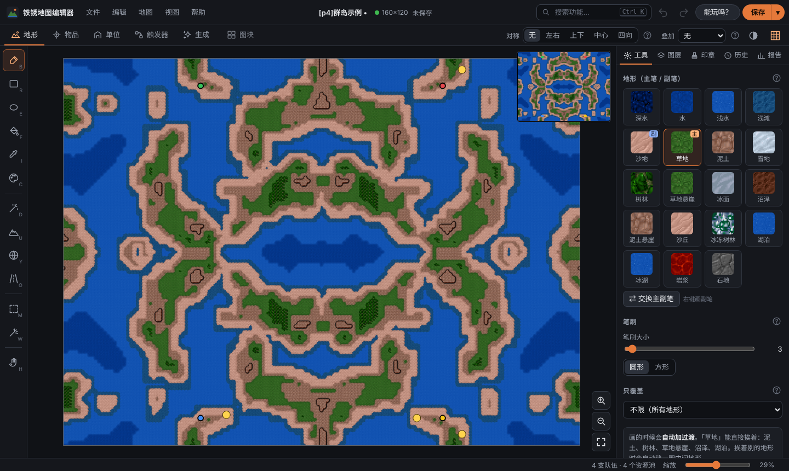
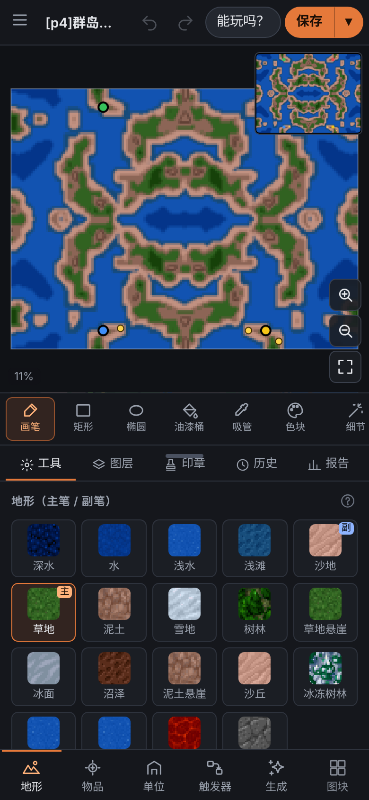

# 铁锈地图编辑器 · Rusted Warfare Map Editor

**中文** · [繁體中文](README.zh-TW.md) · [English](README.en.md) · [日本語](README.ja.md) · [Русский](README.ru.md) · [Español](README.es.md) · [功能总览](docs/FEATURES.md) · [更新日志](CHANGELOG.md) · [反馈问题](https://github.com/WeaverVictorWings/rw-map-editor/issues/new/choose)

给 **铁锈战争（Rusted Warfare）** 用的免费编辑器，非官方：**地图编辑器** 加 **Mod 编辑器**。安卓为主，电脑浏览器也能用。

## 能做什么

**做地图**
- 选“草地、水、沙地”直接画，海岸和悬崖自动接好。
- 出生点、资源池一点就放；画一半，一键镜像成对称图。
- 触发器用“当……就……”卡片，不用记属性名。
- 点“能玩吗？”一键检查，大多数问题能直接修。
- 随机生成、图片转地图、新手向导，几分钟做出一张能玩的图。

**做 Mod**
- 打开 `.rwmod`，用表单改单位，不用手写 ini。
- 复制单位、生成轻型 / 重型变体、数值一键 ×2。
- 对比表、战斗模拟，看新单位强不强。
- 检查缺图、缺音效、写错的引用，打包成 `.rwmod`。

界面有 11 种语言。

## 三步上手

1. 到 [Releases](https://github.com/WeaverVictorWings/rw-map-editor/releases/latest) 下载。手机装 `rw-map-editor.apk`；电脑解压 `rw-map-editor-web.zip`，双击 `Start-Editor.bat`。
2. 第一次先打开一张你已有的铁锈战争地图（.tmx），编辑器会从里面取出图块素材。
3. 新建或继续编辑，点“能玩吗？”检查，再“保存到游戏文件夹”，进游戏就能玩。

不会用？打开后点“新手教程”，共 9 课（地图 7 课、Mod 2 课）跟着做。每个工具旁边的 **?** 都有说明。

## 常见问题

**打开地图后很多格子是紫色或色块？** 这张图引用了游戏自带或外部的图块图片。地图仍然能编辑，游戏里不受影响；想看到真实图块，点“地图 → 补上缺少的地块图”。

**新建地图提示“需要图块素材”？** 编辑器不带游戏素材，先打开任意一张游戏导出的地图，它会自动取出素材。

**手机上很卡？** 超过 1500×1500 的地图很吃内存，建议在电脑上编辑。

**第 11 队以后的出生点没用？** 普通房间只有 10 队，见 [功能总览](docs/FEATURES.md)。

**怎么换语言？** “设置 → 界面语言 · Language”。

**Mod 编辑器在哪？** 首页选“Mod 编辑器”，或点顶栏的“Mod 编辑器”按钮。它的预估数值（DPS、战力、战斗模拟）只是粗略参考，以游戏里为准。

## 反馈与参与

- 发现问题、想要新功能：[提交 Issue](https://github.com/WeaverVictorWings/rw-map-editor/issues/new/choose)。
- 帮忙改翻译：见 [CONTRIBUTING.md](CONTRIBUTING.md)。
- 觉得有用，欢迎点一下右上角的 Star，或者把它推荐给朋友。
- 想改代码：见 [开发说明](docs/DEVELOPMENT.md)。

作者：[@WeaverVictorWings](https://github.com/WeaverVictorWings)。许可证：[MIT](LICENSE)。铁锈战争的游戏素材属于其开发商，本仓库不包含任何游戏素材。
